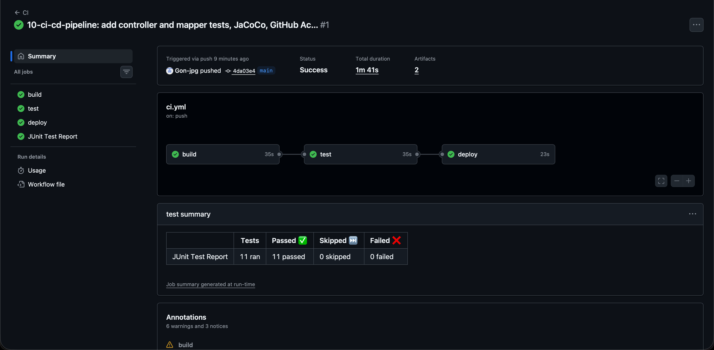

# 10 CI/CD Pipeline (Build/Test/Deploy, Reports) — Antworten

## Vorbereitung

Basis ist das Backend des Recipe Planners aus Block 09 (Stand `main`, ohne Edit-Endpoint), kopiert
nach `recipe-planner/backend/`. Für die Aufgaben sind nur Änderungen im Backend nötig.

```
cd recipe-planner/backend
./mvnw test
```

## Aufgabe 1: Unit Testing

### Controller-Tests (MockMvc)

Datei: `src/test/java/ch/tbz/recipe/planner/controller/RecipeControllerTest.java`

`@WebMvcTest(RecipeController.class)` startet nur die Web-Schicht, `MockMvc` schickt die Requests
ohne echten Server. Service und Mapper sind mit `@MockBean` ersetzt.

| Test | Prüft |
|---|---|
| `getRecipesReturns200AndList` | `GET /api/recipes` -> 200, Liste mit 2 Rezepten in der richtigen Reihenfolge |
| `getRecipeByIdReturns200AndRecipe` | `GET /api/recipes/recipe/{id}` -> 200, Name und Zutat (inkl. Unit) im JSON |
| `addRecipeReturns200AndCallsService` | `POST /api/recipes` mit JSON-Body -> 200, `service.addRecipe` wurde aufgerufen |
| `getRecipeWithUnknownIdCurrentlyReturns200WithEmptyBody` | unbekannte ID -> 200 mit leerem Body (dokumentiert das aktuelle Verhalten) |

**Stolperstein:** `@WebMvcTest` lädt auch `RecipePlannerApplication`. Deren `CommandLineRunner`
`init(RecipeRepository)` braucht ein Repository, das im Web-Slice (ohne JPA) fehlt. Ohne zusätzliches
`@MockBean RecipeRepository` startet der Kontext nicht und alle 4 Tests schlagen mit einem Fehler fehl.

**Befund:** `getRecipeById` verwendet `orElse(null)`, der Controller antwortet bei einer unbekannten
ID trotzdem mit `200 OK` und leerem Body. Korrekt wäre `404 Not Found`. Wird das behoben, muss der
letzte Test angepasst werden.

### Mapper-Tests (SoftAssertions)

Datei: `src/test/java/ch/tbz/recipe/planner/mapper/RecipeEntityMapperTest.java`

Reine JUnit-Tests ohne Spring. MapStruct generiert `RecipeEntityMapperImpl` und
`IngredientEntityMapperImpl` beim Build, diese werden direkt mit `new` erzeugt.

| Test | Prüft |
|---|---|
| `recipeEntityToDomain` / `recipeDomainToEntity` | alle Felder des Rezepts inkl. Zutatenliste, beide Richtungen |
| `ingredientEntityToDomain` / `ingredientDomainToEntity` | id, name, comment, unit, amount, beide Richtungen |
| `ingredientListsAreMappedInBothDirections` | `entitiesToDomains` und `domainsToEntities`, Reihenfolge bleibt erhalten |
| `recipeMappersReturnNullForNullInput` / `ingredientMappersReturnNullForNullInput` | `null` rein -> `null` raus |

Beide Varianten von SoftAssertions kommen vor: `new SoftAssertions()` mit `assertAll()` am Ende und
`SoftAssertions.assertSoftly(softly -> ...)`, das `assertAll()` automatisch aufruft.

**Vorteil von SoftAssertions:** Ein normales `assertEquals` bricht beim ersten Fehler ab, die
weiteren Prüfungen laufen gar nicht. SoftAssertions führen alle Prüfungen aus und melden am Ende alle
Fehler gesammelt. Ein Mapper kopiert viele Felder, ist er kaputt, sind oft mehrere Felder betroffen.
Mit SoftAssertions sieht man in einem Durchlauf jedes falsche Feld, statt Fehler für Fehler zu
beheben und neu zu starten.

```
Tests run: 7, Failures: 0, Errors: 0, Skipped: 0 -- in ...mapper.RecipeEntityMapperTest
Tests run: 4, Failures: 0, Errors: 0, Skipped: 0 -- in ...controller.RecipeControllerTest
Tests run: 11, Failures: 0, Errors: 0, Skipped: 0
BUILD SUCCESS
```

## Aufgabe 2: Reports

* **Surefire** (in Maven standardmässig aktiv): JUnit-XML pro Testklasse in
  `target/surefire-reports/`.
* **JaCoCo** (`jacoco-maven-plugin` 0.8.12 im `pom.xml`): `prepare-agent` hängt den Agent an die
  Test-JVM, `report` in der Phase `test` erzeugt `target/site/jacoco/index.html`.

Beide entstehen automatisch bei jedem `./mvnw test`.

**Coverage:** 46 % der Instruktionen (832 von 1'557 nicht abgedeckt). Hauptgründe: `RecipeService`
ist nirgends getestet (im Controller-Test gemockt), und der von Lombok generierte Code der Entities
und Domänen-Klassen (`equals`, `hashCode`, `toString`) zählt als nicht abgedeckt. Der nächste
sinnvolle Schritt wäre ein Service-Test mit gemocktem Repository.

## Aufgabe 3: Pipeline

**Tool:** GitHub Actions, da das Repository auf GitHub liegt. Datei:
[`.github/workflows/ci.yml`](../.github/workflows/ci.yml) im Hauptverzeichnis des Repositories.

Statt Stages wie in GitLab verwendet GitHub Actions Jobs, die mit `needs:` verkettet werden:

| Job | entspricht Stage | Inhalt |
|---|---|---|
| `build` | build | Java 21 (Temurin) aufsetzen, `./mvnw -B -DskipTests compile` |
| `test` | test | `./mvnw -B test`, Reports als Artefakt `test-reports` hochladen, JUnit-Report als Check veröffentlichen |
| `deploy` | deploy | nur auf `main`: `./mvnw -B -DskipTests package`, Jar als Artefakt `recipe-planner-jar` ablegen |

* **Trigger:** `push` und `pull_request`, eingeschränkt mit `paths` auf `10-ci-cd-pipeline/**` und
  die Workflow-Datei selbst. Änderungen an anderen Blöcken lösen die Pipeline nicht aus.
* **Report pro Durchlauf:** `mikepenz/action-junit-report` liest die Surefire-XML und zeigt das
  Resultat als Check "JUnit Test Report" direkt beim Commit an. Zusätzlich liegen Surefire- und
  JaCoCo-Report als Artefakt `test-reports` beim Run zum Download bereit.
* Reports werden mit `if: always()` auch bei fehlgeschlagenen Tests hochgeladen, gerade dann braucht
  man sie.
* Das Deploy legt das Jar nur als Artefakt ab, das echte Deployment folgt in Block 11.

**Nachweis:** Der Push des Commits "10-ci-cd-pipeline: add controller and mapper tests, JaCoCo,
GitHub Actions pipeline" hat die Pipeline automatisch ausgelöst
([Run 38250875800](https://github.com/Gon-jpg/m450-goncalo/actions/runs/38250875800)):



```
✓ main CI · 38250875800
Triggered via push

JOBS
✓ build in 35s
✓ test in 35s
✓ JUnit Test Report in 0s      -> 11 tests run, 11 passed, 0 skipped, 0 failed.
✓ deploy in 23s

ARTIFACTS
recipe-planner-jar
test-reports
```

**Befund:** GitHub meldet Warnungen, dass `actions/checkout@v4`, `actions/setup-java@v4` und
`actions/upload-artifact@v4` noch auf Node.js 20 laufen, das abgekündigt ist, und dass
`setup-java@v5` verfügbar ist. Die Pipeline läuft trotzdem, die Versionen sollten aber bei Gelegenheit
angehoben werden.
