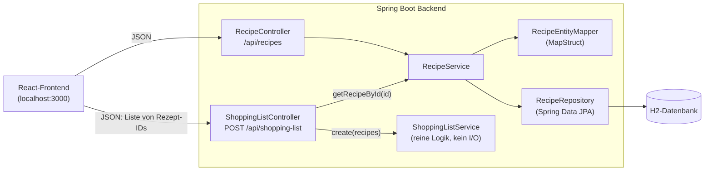

# Block 13 – Planung, Architektur, Testkonzept

## 1. Planung

Vier Feature-PRs als Stapel (jeder baut auf dem vorherigen auf), je ein Branch, Review durch Jan vor dem Merge.

| PR | Branch | Inhalt | Test-Ansatz | Status |
|----|--------|--------|-------------|--------|
| #4 | `feature/shopping-list` | Einkaufsliste: Service + `POST /api/shopping-list` | TDD: 2× Red/Green/Refactor | gemergt in `main` |
| #5 | `feature/recipe-not-found` | Unbekannte Rezept-ID → 404 statt leerer 200-Antwort | Mockito-Service-Test, Controller-Test | gemergt |
| #6 | `feature/shopping-list-ui` | UI: Rezepte wählen, Einkaufsliste anzeigen | Komponenten-Test (Jest/RTL) | gemergt |
| #7 | `feature/integration-test` | Integrationstest des Endpoints gegen die H2-Seed-Daten | `@SpringBootTest` + MockMvc | gemergt |

Reihenfolge: #4 zuerst, weil #6 den Endpoint braucht. #5 ersetzt das vorläufige Verhalten bei unbekannter ID durch einen sauberen 404. #7 schiebt danach den Integrationstest nach.

## 2. Architektur

Ablauf Einkaufsliste: Das Frontend schickt die Rezept-IDs → `ShoppingListController` lädt jedes Rezept über `RecipeService` → `ShoppingListService.create` fasst die Zutaten zusammen → die Liste geht als JSON zurück.

Entscheid: Die Zusammenfassungs-Logik liegt in einem eigenen Service ohne Datenbankzugriff. Dadurch lässt sie sich mit einfachen Unit-Tests prüfen (`new ShoppingListService()`, kein Spring-Kontext).

## 3. Testkonzept

### Ebenen

| Ebene | Was | Werkzeug | Beispiel |
|-------|-----|----------|----------|
| Unit | Fachlogik ohne Spring | JUnit 5, AssertJ | `ShoppingListServiceTest` (10 Tests) |
| Controller-Slice | HTTP-Vertrag, Status, JSON | `@WebMvcTest`, MockMvc, `@MockBean` | `ShoppingListControllerTest` (3), `RecipeControllerTest` (4) |
| Service mit Mocks | Zusammenspiel Service ↔ Repository | Mockito | `RecipeServiceTest` (2) |
| Integration | alle Schichten zusammen gegen die echte DB | `@SpringBootTest`, MockMvc | `ShoppingListIntegrationTest` (1) |
| Mapper | Entity ↔ Domain | MapStruct-Impl direkt | `RecipeEntityMapperTest` (7) |
| Frontend | Auswahl und Anzeige der Einkaufsliste | Jest, React Testing Library (axios gemockt) | `Planer.test.js` (2) |
| Pipeline | Backend- und Frontend-Tests bei jedem Push | GitHub Actions, JaCoCo | Report: https://gon-jpg.github.io/m450-goncalo/ |

Gesamt: 27 Backend-Tests und 2 Frontend-Tests grün (Stand `main`).

### Regeln der Einkaufsliste und ihre Tests

| # | Regel | Test |
|---|-------|------|
| R1 | Alle Zutaten der gewählten Rezepte landen in einer Liste | `singleRecipeReturnsItsIngredients` |
| R2 | Gleicher Name **und** gleiche Einheit → eine Zeile, Mengen addiert | `sameNameAndUnitAreMergedAndAmountsAdded` |
| R3 | Namen werden ohne Gross-/Kleinschreibung und ohne Leerzeichen am Rand verglichen | `namesAreComparedIgnoringCaseAndSurroundingSpaces` |
| R4 | Gleicher Name, andere Einheit → getrennte Zeilen (keine Umrechnung) | `sameNameWithDifferentUnitStaysSeparate` |
| R5 | Sortiert nach Name, Gross-/Kleinschreibung egal | `resultIsSortedByName`, `sortIgnoresCase` |
| R6 | Name wird getrimmt, Schreibweise des ersten Vorkommens bleibt | `firstNameIsTrimmed` |
| R7 | Keine Rezepte / Rezept ohne Zutaten / `ingredients == null` → kein Fehler | `noRecipesGivesEmptyList`, `recipeWithoutIngredientsGivesEmptyList`, `recipeWithNullIngredientsIsSkipped` |
| R8 | Endpoint: IDs in Body-Reihenfolge laden, Liste zurückgeben | `createLoadsRecipesInBodyOrderAndReturnsShoppingList` |
| R9 | Endpoint: leere Liste → `[]` | `emptyBodyGivesEmptyList` |
| R10 | Endpoint: unbekannte ID → 404, keine Einkaufsliste berechnet | `unknownIdReturns404` |

Der Integrationstest deckt R1–R3 zusätzlich gegen die echte H2-Datenbank ab (`ShoppingListIntegrationTest`). `GET /api/recipes/recipe/{id}` mit unbekannter ID gibt ebenfalls 404 (`RecipeControllerTest.getRecipeWithUnknownIdReturns404`).

### Bekannte Lücken

- Die Originalzutaten der Rezepte werden nicht verändert (neue `Ingredient`-Objekte). Dafür gibt es noch keinen Test.
- Zutat ohne Namen (`null`) führt zu einer `NullPointerException`.
- Keine Einheitenumrechnung (z. B. 1 Liter + 2 Deziliter bleiben zwei Zeilen). Das ist Absicht, siehe R4.
- Der Frontend-Test (`Planer.test.js`) ist ein Komponenten-Test mit gemocktem axios, kein Browser-E2E-Test gegen das laufende Backend.

## 4. KI-Deklaration

Gemäss Prüfungs-Checkpoint ist die Deklaration hier im README des Projekts festgehalten.

| | |
|---|---|
| Werkzeug | Claude (Anthropic), über Claude Code |
| Art der Nutzung | Nachschlagewerk für Detailfragen gemäss KI-Nutzungsrahmen (Syntax, Fehlermeldungen, Begriffe) |
| Konkrete Fragen | «Warum schlägt `@WebMvcTest` mit „No qualifying bean of type RecipeEntityMapper“ fehl, obwohl der Controller ihn nicht benutzt?» · «Wie prüfe ich mit Mockito, dass eine Methode gar nicht aufgerufen wurde?» · «Wie gebe ich aus einem Controller 404 zurück, wenn ein `Optional` leer ist?» · «Wie fasst `Map.merge` zwei Werte mit demselben Schlüssel zusammen?» · «Wie mocke ich axios in einem Jest-Test und prüfe, dass die Einkaufsliste angezeigt wird?» · «Läuft der `CommandLineRunner` (Seed-Daten) auch in einem `@SpringBootTest`?» |
| Generierter Code | Ja: Refactor mit `Map.merge` (fast wörtlich übernommen) |
| Von mir selbst geschrieben | Testklassen, Testfälle und Produktivcode der Einkaufsliste, ausser dem Refactor-Vorschlag |
| Von mir geprüft | Antworten gegen die offizielle Dokumentation (JUnit, Mockito, Spring) abgeglichen; Tests lokal ausgeführt; Code gelesen und erklären können |
| Nicht von der KI | Reviews der PRs durch Jan; Entscheide über Merge; Entscheide über Testumfang und Namen |

Die KI-Beteiligung ist in dieser Deklaration festgehalten, nicht in den Commits. Die Reflexion (TDD, KI-Antworten überprüfen, Reviews) steht in [KI-UND-REFLEXION.md](KI-UND-REFLEXION.md).
