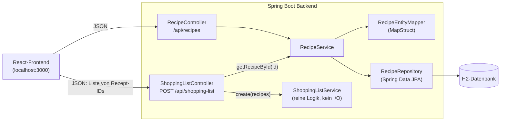

# Block 13 – Planung, Architektur, Testkonzept

## 1. Planung

Drei Feature-PRs, je ein Branch, Review durch Jan vor dem Merge.

| PR | Branch | Inhalt | Test-Ansatz | Status |
|----|--------|--------|-------------|--------|
| #4 | `feature/shopping-list` | Einkaufsliste: Service + `POST /api/shopping-list` | TDD: 2× Red/Green/Refactor | PR #4 offen, Review durch Jan ausstehend |
| #5 | `feature/recipe-not-found` | Unbekannte Rezept-ID → 404 statt leerer 200-Antwort | Mockito-Service-Test, Controller-Test | offen |
| #6 | `feature/shopping-list-ui` | UI: Rezepte wählen, Einkaufsliste anzeigen | Komponenten-/E2E-Test | offen |

Reihenfolge: PR #4 zuerst, weil PR #6 den Endpoint braucht. PR #5 ersetzt das vorläufige Verhalten bei unbekannter ID durch einen sauberen 404.

## 2. Architektur

Ablauf Einkaufsliste: Das Frontend schickt die Rezept-IDs → `ShoppingListController` lädt jedes Rezept über `RecipeService` → `ShoppingListService.create` fasst die Zutaten zusammen → die Liste geht als JSON zurück.

Entscheid: Die Zusammenfassungs-Logik liegt in einem eigenen Service ohne Datenbankzugriff. Dadurch lässt sie sich mit einfachen Unit-Tests prüfen (`new ShoppingListService()`, kein Spring-Kontext).

## 3. Testkonzept

### Ebenen

| Ebene | Was | Werkzeug | Beispiel |
|-------|-----|----------|----------|
| Unit | Fachlogik ohne Spring | JUnit 5, AssertJ | `ShoppingListServiceTest` (10 Tests) |
| Controller-Slice | HTTP-Vertrag, Status, JSON | `@WebMvcTest`, MockMvc, `@MockBean` | `ShoppingListControllerTest` (3), `RecipeControllerTest` (4) |
| Service mit Mocks | Zusammenspiel Service ↔ Repository | Mockito | PR #5 |
| Mapper | Entity ↔ Domain | MapStruct-Impl direkt | `RecipeEntityMapperTest` (7) |
| Pipeline | alles bei jedem Push | GitHub Actions, JaCoCo | Report: https://gon-jpg.github.io/m450-goncalo/ |

Gesamt: 24 Tests grün (Stand PR #4).

### Regeln der Einkaufsliste und ihre Tests

| # | Regel | Test |
|---|-------|------|
| R1 | Alle Zutaten der gewählten Rezepte landen in einer Liste | `singleRecipeReturnsItsIngredients` |
| R2 | Gleicher Name **und** gleiche Einheit → eine Zeile, Mengen addiert | `sameNameAndUnitAreMergedAndAmountsAdded` |
| R3 | Namen werden ohne Gross-/Kleinschreibung und ohne Leerzeichen am Rand verglichen | `namesAreComparedIgnoringCaseAndSurroundingSpaces` |
| R4 | Gleicher Name, andere Einheit → getrennte Zeilen (keine Umrechnung) | `sameNameWithDifferentUnitStaysSeparate` |
| R5 | Sortiert nach Name, Gross-/Kleinschreibung egal | `resultIsSortedByName`, `sortIgnoresCase` |
| R6 | Name wird getrimmt, Schreibweise des ersten Vorkommens bleibt | `firstNameIsTrimmed` |
| R7 | Keine Rezepte / Rezept ohne Zutaten / `ingredients == null` → kein Fehler | `noRecipesGivesEmptyList`, `recipeWithoutIngredientsGivesEmptyList`, `recipeWithNullIngredientsIsSkipped` |
| R8 | Endpoint: IDs in Body-Reihenfolge laden, Liste zurückgeben | `createLoadsRecipesInBodyOrderAndReturnsShoppingList` |
| R9 | Endpoint: leere Liste → `[]` | `emptyBodyGivesEmptyList` |
| R10 | Endpoint: unbekannte ID wird ignoriert; ab PR #5 → 404 | `unknownIdIsIgnored` |

### Bekannte Lücken

- Die Originalzutaten der Rezepte werden nicht verändert (neue `Ingredient`-Objekte). Dafür gibt es noch keinen Test.
- Zutat ohne Namen (`null`) führt zu einer `NullPointerException`.
- Keine Einheitenumrechnung (z. B. 1 Liter + 2 Deziliter bleiben zwei Zeilen). Das ist Absicht, siehe R4.
- Ob die Einkaufsliste im Frontend richtig angezeigt wird, prüft erst PR #6.
